# Audio EDA report: Schematics NPC DSC 2026 bird classification
_Generated by `DSC_Pipeline/eda/run_eda.py`. All numbers are reproducible with SEED=42._
## 1. Snapshot
- Train files scanned: **1826** (metadata rows: 1826), test files scanned: **814**
- Classes: {'Bondol Jawa': 1124, 'Kutilang': 619, 'Cendrawasih': 83}
- Source groups (train): **15**; per class: {'Bondol Jawa': 7, 'Cendrawasih': 4, 'Kutilang': 4}
- Sample rate by split: {'test': {'48000': 814}, 'train': {'48000': 1826}}; channels: {'test': {'2': 814}, 'train': {'2': 1826}}; subtype: {'test': {'PCM_24': 814}, 'train': {'PCM_24': 1826}}
- Duration (s): train {'min': 5.269, '25%': 8.438, '50%': 10.029, '75%': 11.696, 'max': 14.9}, test {'min': 5.549, '25%': 8.584, '50%': 10.09, '75%': 11.66, 'max': 14.9}

## 2. Findings and flags
- **ALERT** Random CV overestimates logreg macro F1 by 0.19 versus group-aware CV. Always validate on `source_group`.
- **ALERT** Random CV overestimates random_forest macro F1 by 0.22 versus group-aware CV. Always validate on `source_group`.
- **WARN** Strong class imbalance (13.5:1). Smallest class is **Cendrawasih** with 83 files. Macro F1 weights every class equally, so use class weights / balanced sampling and report per-class F1.
- **WARN** Only 15 source groups in total: group K-fold has very few units, so CV scores will have high variance.
- **WARN** A classifier separates train from test with AUC 0.79: test comes from a different distribution (new sources, conditions, or unseen species).
- **INFO** Periodic stripe/gating artifact (strongly periodic 8-14 kHz envelope, threshold 0.5): 34% of train and 28% of test files; by class {'Bondol Jawa': 0.343, 'Cendrawasih': 0.325, 'Kutilang': 0.333}. Its share is similar across classes (spread 2%) and source groups (spread 13%), so it is unlikely to leak the label, but it is a nuisance pattern worth masking or augmenting around.

## 3. Class and source-group structure
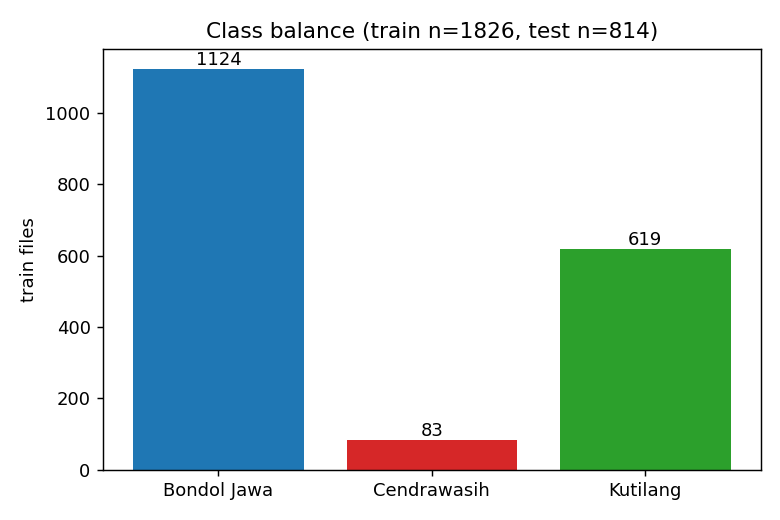

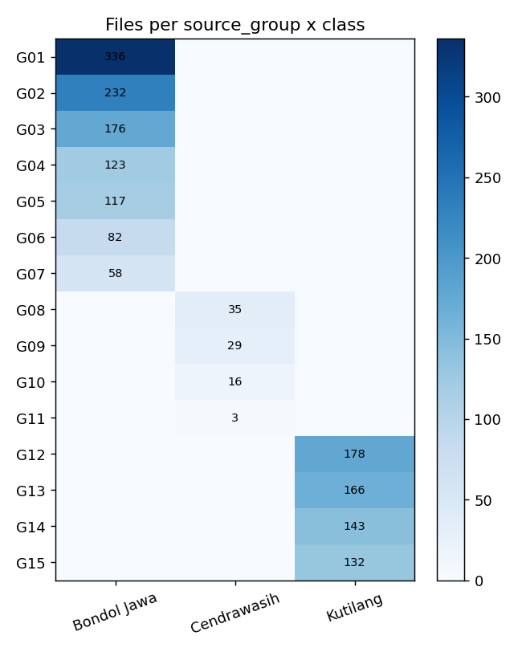

| gid | label | n | n_labels | total_minutes |
|---|---|---|---|---|
| G01 | Bondol Jawa | 336 | 1 | 54.693 |
| G02 | Bondol Jawa | 232 | 1 | 39.180 |
| G03 | Bondol Jawa | 176 | 1 | 28.398 |
| G04 | Bondol Jawa | 123 | 1 | 20.377 |
| G05 | Bondol Jawa | 117 | 1 | 20.156 |
| G06 | Bondol Jawa | 82 | 1 | 13.412 |
| G07 | Bondol Jawa | 58 | 1 | 9.443 |
| G08 | Cendrawasih | 35 | 1 | 5.996 |
| G09 | Cendrawasih | 29 | 1 | 5.117 |
| G10 | Cendrawasih | 16 | 1 | 2.942 |
| G11 | Cendrawasih | 3 | 1 | 0.369 |
| G12 | Kutilang | 178 | 1 | 30.116 |
| G13 | Kutilang | 166 | 1 | 28.352 |
| G14 | Kutilang | 143 | 1 | 24.248 |
| G15 | Kutilang | 132 | 1 | 22.684 |

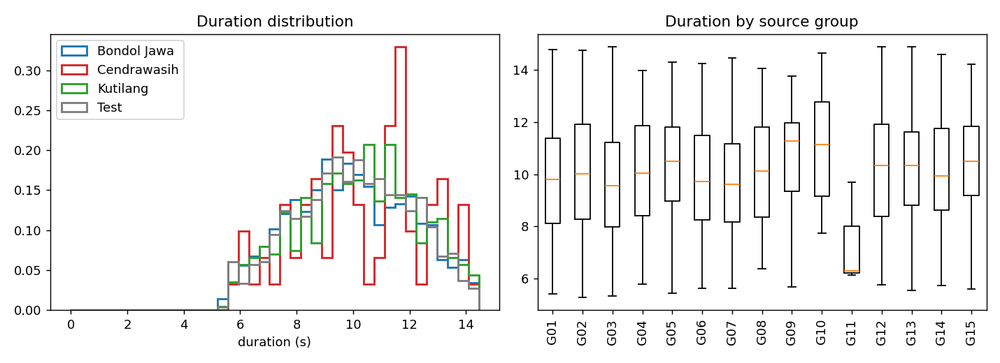

## 4. Recording quality and spectral character
Rain and wind raise energy below ~500 Hz and flatten the spectrum; insects add narrow high-frequency bands; a high noise floor with low dynamic range indicates a noisy recording.

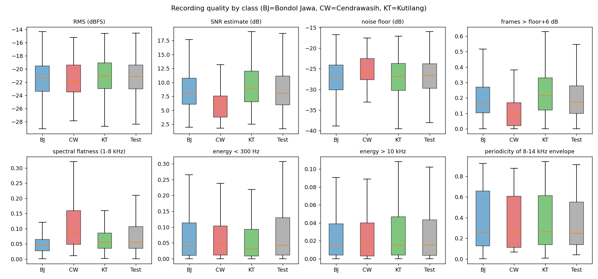

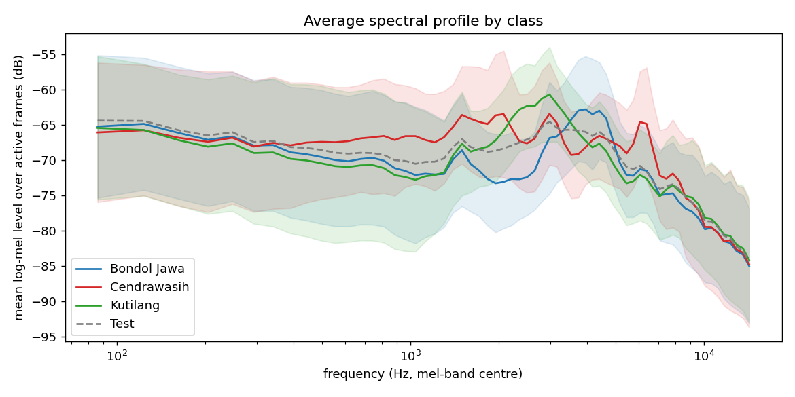

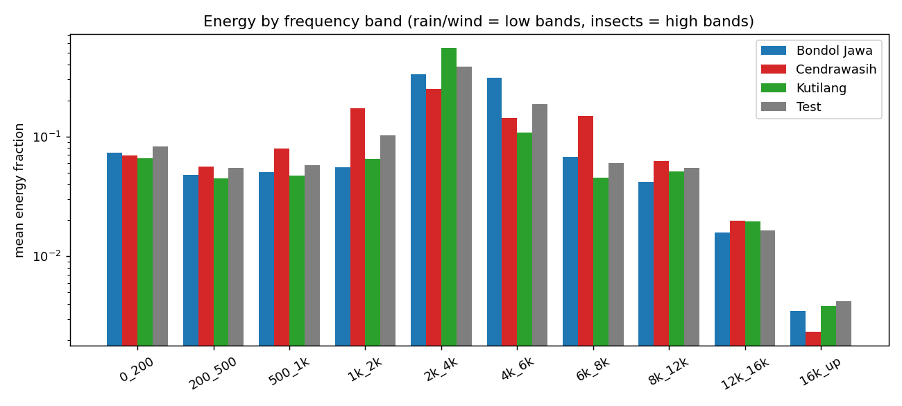

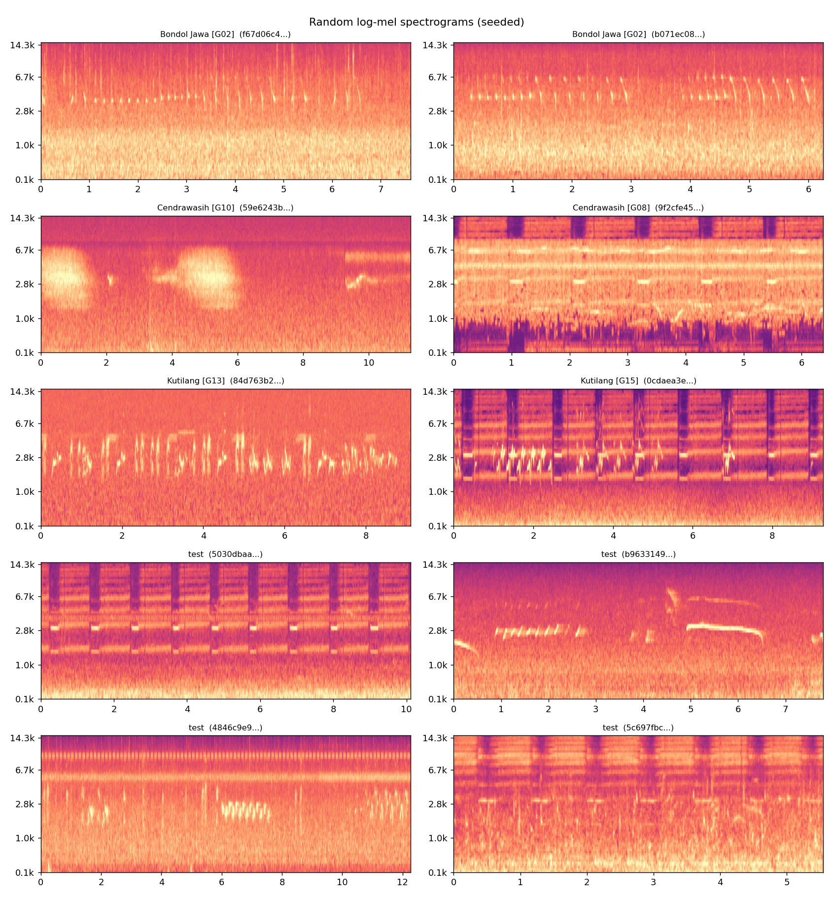

## 5. Class signal versus recording-source signal
`eta^2` is the share of a feature's variation explained by species; `adj R^2 (group | class)` is what the source group still explains after the class mean is removed. Features high in the second column describe the recording setup, not the bird.

| feature | eta2_class | adj_r2_group_within_class |
|---|---|---|
| bf_4k_6k | 0.318 | 0.127 |
| bf_2k_4k | 0.245 | 0.163 |
| frame_centroid_hz | 0.182 | 0.021 |
| peak_freq_hz | 0.147 | 0.023 |
| bf_1k_2k | 0.076 | 0.029 |
| bf_6k_8k | 0.076 | 0.076 |
| n_events | 0.065 | 0.195 |
| rolloff85_hz | 0.064 | 0.014 |
| mel_flux | 0.059 | 0.055 |
| spec_centroid_hz | 0.051 | 0.011 |
| flatness_active | 0.046 | 0.064 |
| event_ratio | 0.039 | 0.026 |

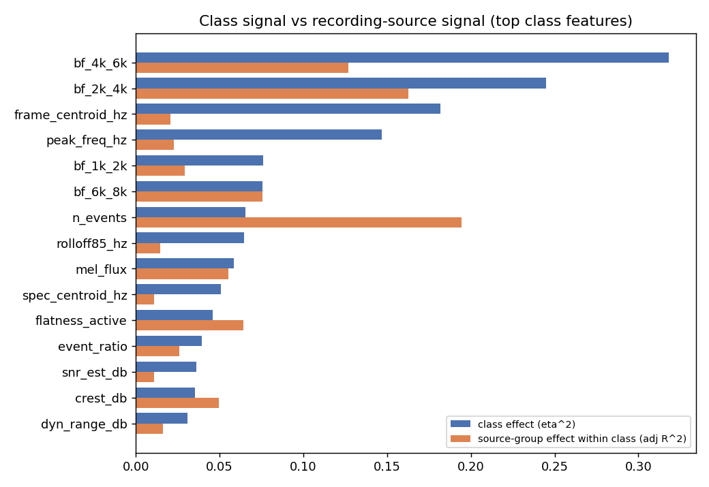

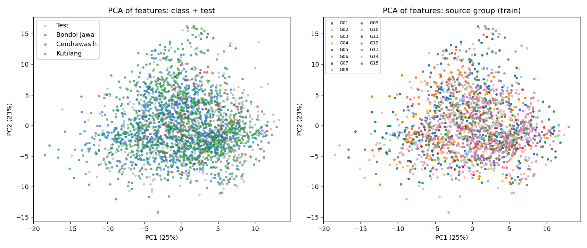

### Baseline probes (hand-crafted features + mel profile)
| setting | macro_f1_3_classes | F1 Bondol Jawa | F1 Cendrawasih | F1 Kutilang |
|---|---|---|---|---|
| logreg_random_cv | 0.890 | 0.962 | 0.778 | 0.931 |
| logreg_group_cv | 0.696 | 0.929 | 0.267 | 0.891 |
| random_forest_random_cv | 0.807 | 0.949 | 0.564 | 0.907 |
| random_forest_group_cv | 0.591 | 0.908 | 0.024 | 0.841 |

Group CV used 4 folds. Pooled leave-one-group-out macro F1 (logreg): 0.848

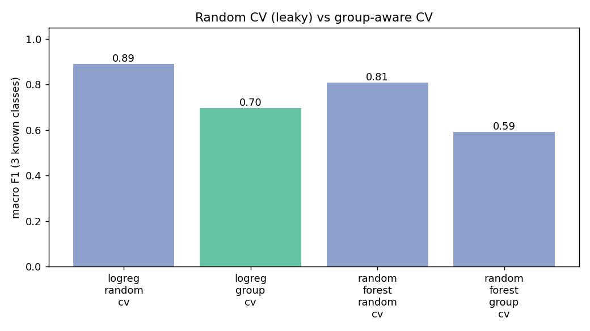

Accuracy when each source group is held out entirely:

| gid | label | n | accuracy_when_held_out | class_present_in_other_groups |
|---|---|---|---|---|
| G01 | Bondol Jawa | 336 | 0.958 | 6 |
| G02 | Bondol Jawa | 232 | 0.961 | 6 |
| G03 | Bondol Jawa | 176 | 0.926 | 6 |
| G04 | Bondol Jawa | 123 | 0.984 | 6 |
| G05 | Bondol Jawa | 117 | 0.957 | 6 |
| G06 | Bondol Jawa | 82 | 0.671 | 6 |
| G07 | Bondol Jawa | 58 | 0.914 | 6 |
| G08 | Cendrawasih | 35 | 0.686 | 3 |
| G09 | Cendrawasih | 29 | 1.000 | 3 |
| G10 | Cendrawasih | 16 | 0.062 | 3 |
| G11 | Cendrawasih | 3 | 0.667 | 3 |
| G12 | Kutilang | 178 | 0.978 | 3 |
| G13 | Kutilang | 166 | 0.958 | 3 |
| G14 | Kutilang | 143 | 0.923 | 3 |
| G15 | Kutilang | 132 | 0.902 | 3 |

## 6. Train versus test shift and the Unknown class
- Adversarial validation AUC (train vs test): **0.785** (0.5 = indistinguishable)
- Features with BH-adjusted KS p<0.01: 9 of 40
- Nearest-neighbour distance quantiles, train (other sources): {'p50': 4.465, 'p90': 5.936, 'p95': 6.572, 'p99': 8.291}
- Test: {'p50': 4.754, 'p90': 6.7, 'p95': 7.258, 'p99': 8.468}
- Share of test above the train p95 / p99 distance: 0.111 / 0.015 (5% / 1% if test were as familiar as unseen train sources)

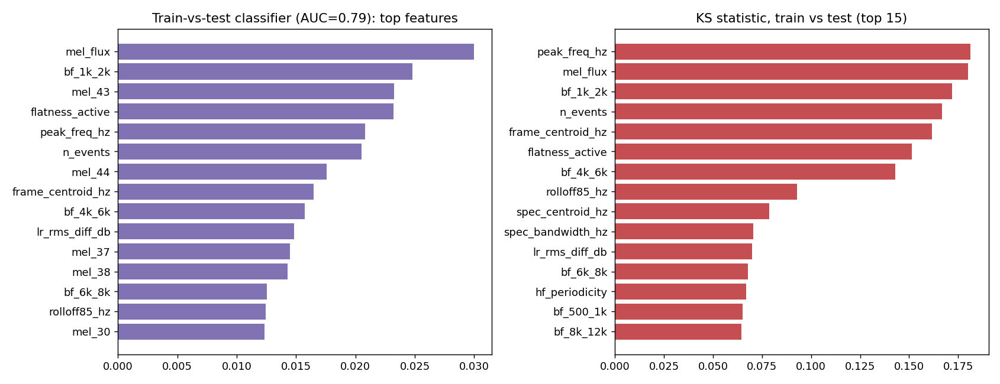

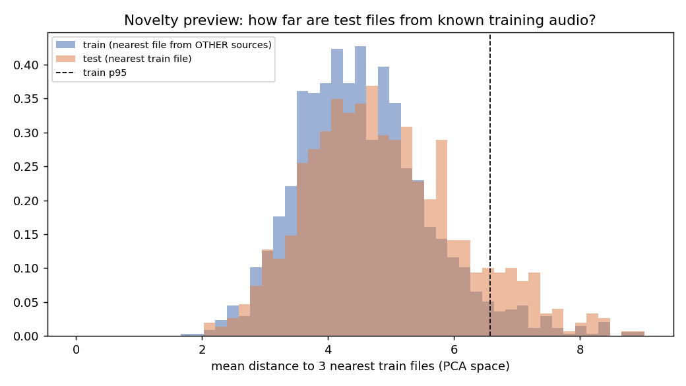

### Open-set feasibility (leave-one-class-out)
Each known class is treated as the unseen one; AUROC measures how well a detector built on the other classes scores it above held-out known files. Values near 0.5 mean the feature space cannot reject novel species.

| held_out_class | method | auroc | folds |
|---|---|---|---|
| Bondol Jawa | knn | 0.740 | 3 |
| Bondol Jawa | isolation_forest | 0.642 | 3 |
| Bondol Jawa | max_softmax_prob | 0.733 | 3 |
| Cendrawasih | knn | 0.787 | 3 |
| Cendrawasih | isolation_forest | 0.723 | 3 |
| Cendrawasih | max_softmax_prob | 0.591 | 3 |
| Kutilang | knn | 0.667 | 3 |
| Kutilang | isolation_forest | 0.660 | 3 |
| Kutilang | max_softmax_prob | 0.645 | 3 |

Mean AUROC by method: {'isolation_forest': 0.675, 'knn': 0.731, 'max_softmax_prob': 0.656}

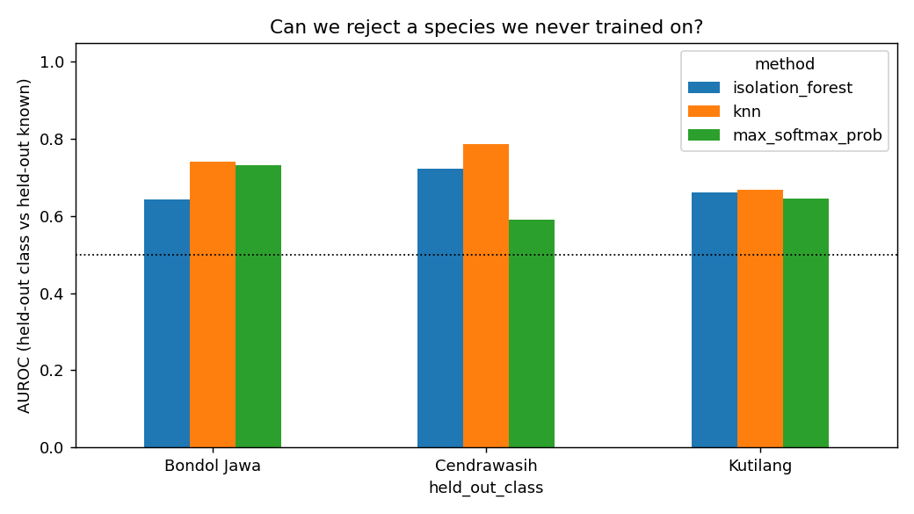

`tables/test_novelty_scores.csv` holds an unsupervised distance score per test file. It is descriptive only: it is not a label and must not be written into a submission without a trained, validated model.

## 7. Modelling implications
- Validation: `StratifiedGroupKFold(n_splits=4, shuffle=True, random_state=42)` on `source_group`; never split segments of one source across train and validation.
- Imbalance 13.5:1: use class-weighted loss or balanced sampling; tune per-class thresholds on out-of-fold predictions.
- Audio is ['48000'] Hz with median L/R correlation 0.89; down-mix to mono (or keep both channels as augmentation) and resample once.
- Median clip is 10.029 s (max 14.9 s): crop or tile to fixed windows and average window predictions per file.
- For Unknown, the best simple detector in feature space was `knn` (mean AUROC 0.731). Combine it with a closed-set confidence score and choose the threshold by macro F1 on simulated unknowns (hold out one class at a time) using group-aware folds.

## 8. Files produced
- `tables/features.csv`, `tables/mel_stats.npz`, `tables/summary.json`, `tables/*.csv`
- `figures/*.png`

## 9. Rule compliance notes
- Only competition-provided data is used; no external audio or pretrained models.
- Test audio is used as unlabeled data for distribution comparison only; no hand labeling or manual inspection of test labels.
- All random operations use SEED=42. Plots of test spectrograms are random draws, not curated.
